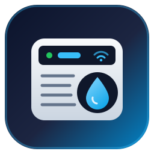
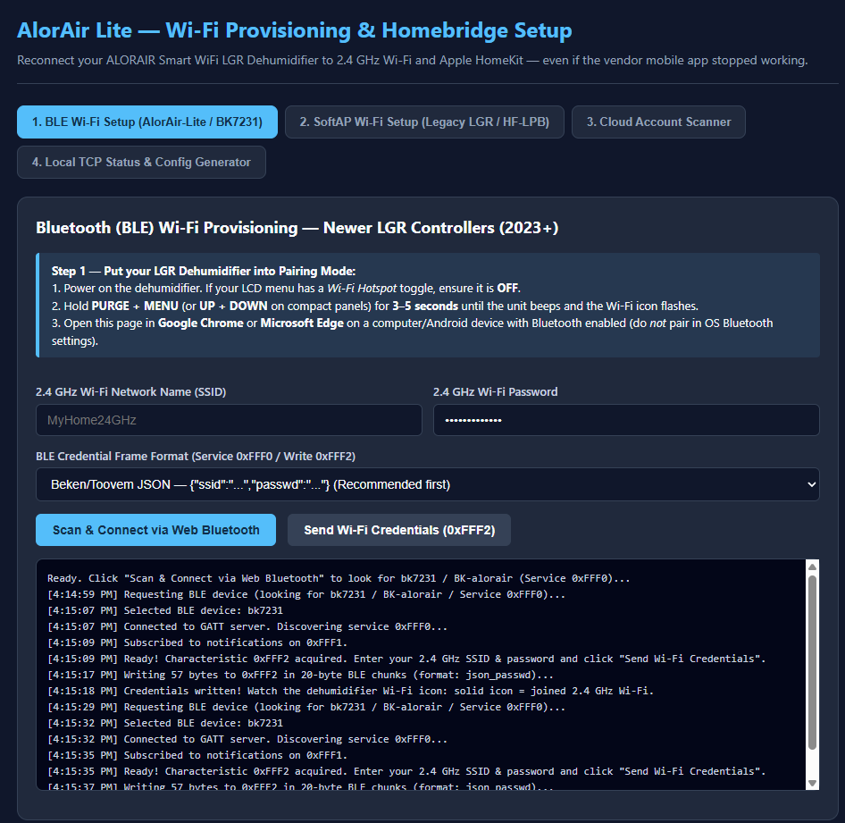
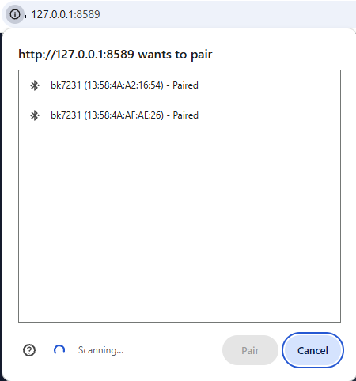
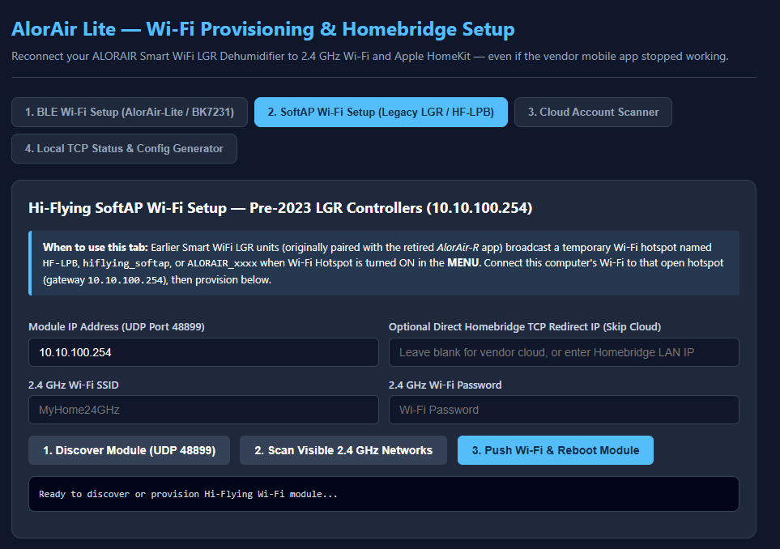
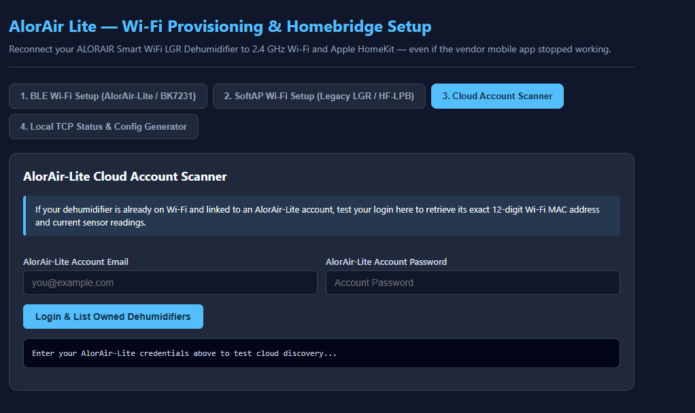
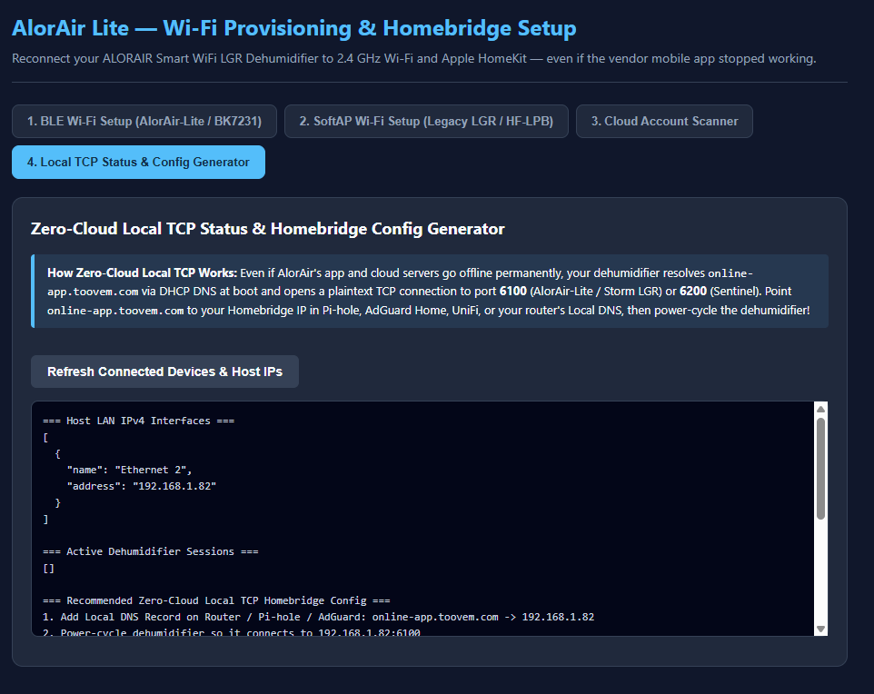

<p align="center">
  
</p>

<h1 align="center">homebridge-alorair-lite</h1>

<p align="center">
  <strong>Full-Featured Homebridge Plugin &amp; Local Wi-Fi Recovery Toolkit for ALORAIR Smart WiFi LGR Dehumidifiers in Apple HomeKit</strong>
</p>

<p align="center">
  <a href="https://github.com/homebridge/homebridge/wiki/Verified-Plugins"></a>
  <a href="https://github.com/NightPants/Homebridge-Alorair-Lite/actions/workflows/build.yml"></a>
  <a href="https://www.npmjs.com/package/homebridge-alorair-lite"></a>
  <a href="https://github.com/homebridge/homebridge"></a>
  <a href="LICENSE"></a>
</p>

---

**`homebridge-alorair-lite`** brings **ALORAIR Smart WiFi LGR Dehumidifiers** (Storm Pro, Storm LGR Extreme, Storm LGR 850X / 1250X, Storm SLGR, Storm Ultra, Storm Elite, plus Sentinel models in Local TCP `auto` mode) natively into **Apple HomeKit** and **Siri**.

### Official AlorAir Mobile App Stopped Working? We've Got You Covered!

Many AlorAir owners have been locked out of their Smart WiFi LGR dehumidifiers because the retired *AlorAir-R* app was removed and the newer *AlorAir-Lite* app frequently fails during Bluetooth/Wi-Fi onboarding or cloud sign-in.

`homebridge-alorair-lite` includes **built-in Wi-Fi recovery and zero-cloud local control** so your unit works **even without a working AlorAir mobile app or cloud account**:

1. **Built-in Wi-Fi Recovery Wizard (`npx homebridge-alorair-lite-setup`)** — Reconnects both **2023+ Beken `BK7231` BLE** LGR controllers (via Chrome/Edge Web Bluetooth on GATT Service `0xFFF0`) and **pre-2023 Hi-Flying `HF-LPB` SoftAP** LGR controllers (via UDP port `48899` / `10.10.100.254`) directly onto your local 2.4 GHz Wi-Fi.
2. **Zero-Cloud Local TCP Mode (`transport: "local"`)** — Point vendor DNS hostnames (`online-app.toovem.com`, `online-app1.toovem.com`, `app.alorair.com`, `app.baseaire.com`) to your Homebridge IP in your router / Pi-hole / AdGuard Home DNS. Your dehumidifier connects directly to Homebridge on LAN TCP port **`6100`**, **`6200`**, or **`4802`** (all three ports are automatically bound in `controllerProfile: "auto"`, supporting multiple dehumidifiers simultaneously) with **zero vendor cloud dependency and zero account required**.
3. **AlorAir-Lite Cloud Mode (`transport: "cloud"`)** — Also supports full AlorAir-Lite REST cloud polling & control (`online-app1.toovem.com:8081`) when your unit is already linked to an AlorAir-Lite account, including filter hour counters and error bitmasks.

---

## Supported Hardware

| Series / Controller | Models | Local TCP | Cloud API | Built-in Wi-Fi Recovery |
| :--- | :--- | :---: | :---: | :---: |
| **AlorAir-Lite Commercial LGR (2023+)** | Storm Pro, Storm LGR Extreme, Storm LGR 850X / 1250X, Storm SLGR 850X / 1250X / 1600X, Storm Ultra, Storm Elite (`BK7231` BLE + Wi-Fi) | Port `6100` / `4802` | Yes | Web Bluetooth (`0xFFF0` / `0xFFF2`) |
| **Legacy Smart WiFi LGR (Pre-2023)** | Earlier Storm LGR / Pro Wi-Fi units shipped for *AlorAir-R* (`Hi-Flying HF-LPB` SoftAP) | Port `6100` | Firmware-dependent | SoftAP UDP `48899` + Direct TCP Redirect |
| **AlorAir Sentinel Series** | Sentinel HD55S, HDi65S, HDi90, HDi100, HDi120 (`AlorAir-C` protocol) | Port `6200` (`controllerProfile: "auto"`) | Separate vendor API | SoftAP / Vendor C-App |

---

## Apple HomeKit Experience

Each dehumidifier is exposed cleanly in the **Apple Home** app (iPhone, iPad, Mac, Apple Watch, HomePod, Apple TV):

| HomeKit Accessory / Service | Default | HAP Service Type | Behavior & Controls |
| :--- | :---: | :--- | :--- |
| **Dehumidifier** *(Main Tile)* | **Enabled** | `HumidifierDehumidifier` | Power On/Off (`Active`), live operating state (`Dehumidifying` / `Idle` / `Off`), live intake RH%, and target humidity slider (`20%` = **Continuous `"CO"`**, `25%–80%` in `5%` steps = **Auto**) |
| **Intake Temperature** *(Linked)* | **Enabled** | `TemperatureSensor` | Live intake air temperature (°C / °F converted automatically by HomeKit) |
| **Air Filter** *(Linked, Cloud)* | **Auto** | `FilterMaintenance` | Filter life remaining `%`, low-filter alert (`<= 10%`), and filter timer reset |
| **Continuous Mode** | **Enabled** | `Switch` | One-tap / Siri toggle between **Continuous (`"CO"`)** and your last Auto RH% setpoint |
| **Purge Drain** | **Enabled** *(Cloud)* | `Switch` | Triggers the condensate pump purge cycle (`frameType "22"`), auto-reflecting active drain state |
| **Problem Alert** | **Enabled** *(Cloud)* | `ContactSensor` | `Closed` = Healthy; `Open` = Hardware Fault (`E1`, `L0`, `HI`, `E5`, `E4`, `E3`, `E7`) for native iPhone push notifications! |
| **Locate** | Optional | `Switch` | Triggers the dehumidifier's audible/visual locate beacon (`frameType "27"`) |
| **Draining** | Optional | `OccupancySensor` | Indicates whenever the condensate drain pump is actively running |
| **Outlet Sensors** | Optional | `TemperatureSensor` + `HumiditySensor` | Exhaust air temperature and relative humidity |

### Built-In Appliance Protections

- **3-Minute Compressor Short-Cycle Guard**: Enforces a mandatory `180s` minimum off-time after powering off (or after startup/disconnect) before allowing a power-on command, protecting your LGR compressor from liquid-slugging or rapid short-cycling.
- **No Blind Command Retries**: Outbound Cloud and Local TCP commands are serialized and never blindly retried on ambiguous network timeouts. Local TCP commands enforce `>= 1.1s` spacing and verify post-command status frames strictly past the outbound TCP byte boundary.
- **Accessory Cache Hydration**: Cached HomeKit tiles stay registered across Homebridge restarts or temporary Wi-Fi outages so your Apple Home rooms, scenes, and automations are never wiped out.

---

## Step 1: Reconnect Your Dehumidifier to Local 2.4 GHz Wi-Fi (No Vendor App Needed)

If your dehumidifier is currently offline or disconnected from Wi-Fi, run the built-in interactive Setup Wizard or Web Portal!

> **Important:** All AlorAir Wi-Fi modules only support **2.4 GHz Wi-Fi (`802.11b/g/n`)**. Ensure your 2.4 GHz SSID uses WPA2-PSK (or WPA2/WPA3 mixed mode with PMF optional).

### Option A: Launch the Interactive Web Setup Portal (Recommended)

From any computer with Node.js 20+ (or on your Homebridge host):

```bash
npx homebridge-alorair-lite-setup portal
```

Open **`http://127.0.0.1:8589`** in **Google Chrome** or **Microsoft Edge**:

1. **For 2023+ LGR Units (`BK7231` Bluetooth Onboarding)**:
   - Power on the dehumidifier. Hold **`PURGE + MENU`** (or **`UP + DOWN`** on compact 4-button panels) for **3–5 seconds** until the unit beeps and enters Bluetooth pairing mode.
   - In Tab 1 (*BLE Wi-Fi Setup*), click **Scan & Connect via Web Bluetooth**, select `bk7231` / `BK-alorair`, enter your 2.4 GHz SSID & password, and click **Send Wi-Fi Credentials**.
2. **For Pre-2023 LGR Units (`HF-LPB` Wi-Fi Hotspot Onboarding)**:
   - Press **`MENU`** on the dehumidifier LCD and turn **Wi-Fi Hotspot ON** (or hold **`PURGE + MENU`**).
   - Connect your laptop's Wi-Fi to the unit's open hotspot (`HF-LPB`, `hiflying_softap`, or `ALORAIR_xxxx`).
   - In Tab 2 (*SoftAP Wi-Fi Setup*), enter your 2.4 GHz SSID & password (and optionally enter your Homebridge LAN IP in *Direct Homebridge TCP Redirect IP* to skip DNS configuration completely!), then click **Push Wi-Fi & Reboot Module**.

#### Built-in Setup Portal Screenshots

<p align="center">
  
</p>

<p align="center">
  
</p>

<p align="center">
  
</p>

<p align="center">
  
</p>

<p align="center">
  
</p>

### Option B: Command-Line Provisioning & Diagnostics

```bash
# Discover Hi-Flying Wi-Fi modules on SoftAP (10.10.100.254) or LAN
npx homebridge-alorair-lite-setup discover-softap 10.10.100.254

# Scan visible 2.4 GHz networks from the dehumidifier's SoftAP
npx homebridge-alorair-lite-setup scan-softap 10.10.100.254

# Push 2.4 GHz Wi-Fi credentials AND point TCP directly to Homebridge (192.168.1.50:6100)
npx homebridge-alorair-lite-setup provision-softap \
  --ssid "MyHome24G" \
  --password "MyWifiPassword" \
  --redirect-host 192.168.1.50 \
  --redirect-port 6100

# Or start a temporary Local TCP listener to verify your dehumidifier connects & learn its MAC
npx homebridge-alorair-lite-setup listen-local 6100
```

See **[docs/WIFI_PROVISIONING.md](docs/WIFI_PROVISIONING.md)** for full hardware identification, LCD button combinations, and troubleshooting.

---

## Step 2: Install in Homebridge

### Via Homebridge UI (`hb-service` / Config UI X)

1. Open the **Homebridge UI** in your browser.
2. Navigate to the **Plugins** tab and search for **`homebridge-alorair-lite`**.
3. Click **Install**, then click **Settings** to configure via the graphical form (powered by `config.schema.json`).

### Via Command Line / Manual Git Clone

```bash
# Install from npm globally
npm install -g homebridge-alorair-lite

# Or install directly from a local clone for development
git clone https://github.com/NightPants/Homebridge-Alorair-Lite.git
cd Homebridge-Alorair-Lite
npm install
npm run build
npm link
```

---

## Step 3: Choose Your Transport Mode

### Mode A: Zero-Cloud Local TCP (`"transport": "local"`) — *Best if the AlorAir App Doesn't Work!*

Once your dehumidifier is connected to your 2.4 GHz Wi-Fi, it resolves vendor hostnames via DNS and opens an outbound TCP connection to port **`6100`** or **`4802`** (`6200` on Sentinel units). It does **not** verify TLS certificates (the protocol is raw binary TCP).

1. **Add Local DNS Records** on your router, **Pi-hole**, **AdGuard Home**, **UniFi**, **pfSense/OPNsense**, or **OpenWrt** pointing to your **`<YOUR_HOMEBRIDGE_LAN_IP>`** (e.g., `192.168.1.50`):
   - **`online-app.toovem.com`**
   - **`online-app1.toovem.com`**
   - **`app.alorair.com`**
   - **`app.baseaire.com`**
   *(See [docs/LOCAL_CONTROL.md](docs/LOCAL_CONTROL.md) for step-by-step router instructions.)*
2. **Configure `homebridge-alorair-lite`** with `"transport": "local"` and `"listenPort": 6100` (`6200` for Sentinel). Leave `"mac"` blank on first boot if you don't know your unit's MAC — the plugin will auto-discover it as soon as the unit connects and print the MAC in the Homebridge log!
3. **Power-cycle the dehumidifier completely** (**unplug the AC power cord from the wall outlet for 10–15 seconds**, then plug it back in — pressing the front-panel power button does not reboot the internal Wi-Fi module) so it resolves the new DNS record immediately.

```json
{
  "platforms": [
    {
      "platform": "AlorairLite",
      "name": "Crawlspace Dehumidifier",
      "transport": "local",
      "listenHost": "0.0.0.0",
      "listenPort": 6100,
      "controllerProfile": "auto",
      "allowLocalPowerOn": true,
      "enforceCompressorRestartDelay": true,
      "exposeInletHumidity": true,
      "exposeInletTemperature": true,
      "exposeContinuousSwitch": true,
      "exposeDrainingSensor": true,
      "exposeOutletSensors": false,
      "enableSetupPortal": true,
      "setupPortalHost": "127.0.0.1",
      "setupPortalPort": 8589
    }
  ]
}
```

### Mode B: AlorAir-Lite Cloud API (`"transport": "cloud"`)

If your dehumidifier is already paired to an active **AlorAir-Lite** account and has internet access, simply provide your email and password. All owned dehumidifiers on your account are discovered automatically (or filter to one unit via `"mac"`).

> **Security Note:** AlorAir's cloud API (`http://online-app1.toovem.com:8081/rest/api/`) uses RSA-PKCS1v15 encryption for the login password payload, but the vendor server only speaks **unencrypted HTTP** (no HTTPS listener). Therefore `"allowInsecureHttp": true` is required for Cloud mode, or use Local TCP mode on your private LAN.

```json
{
  "platforms": [
    {
      "platform": "AlorairLite",
      "name": "AlorAir Lite",
      "transport": "cloud",
      "email": "you@example.com",
      "password": "YourAlorAirLitePassword",
      "allowInsecureHttp": true,
      "pollIntervalSeconds": 30,
      "enforceCompressorRestartDelay": true,
      "exposeInletHumidity": true,
      "exposeInletTemperature": true,
      "exposeContinuousSwitch": true,
      "exposePurgeSwitch": true,
      "exposeProblemSensor": true
    }
  ]
}
```

---

## Full Configuration Reference

| Property | Type | Default | Description |
| :--- | :--- | :--- | :--- |
| `platform` | `string` | `"AlorairLite"` | **Required.** Must be `"AlorairLite"`. |
| `name` | `string` | `"AlorAir Lite"` | Display name in logs and default HomeKit name in Local TCP mode. |
| `transport` | `"local" \| "cloud"` | `"local"` *(or `"cloud"` if credentials set)* | Select Zero-Cloud Local TCP listener or AlorAir-Lite Cloud REST polling. |
| `mac` | `string` | `""` *(auto-discover)* | Optional 12-hex Wi-Fi MAC (`AABBCCDDEEFF` or `AA:BB:CC:DD:EE:FF`) to pin to a specific unit. |
| `listenHost` | `string` | `"0.0.0.0"` | *(Local)* Local IPv4 interface to bind the TCP server on. |
| `listenPort` | `number` | `6100` | *(Local)* TCP port (`6100` for AlorAir-Lite / Storm LGR; `6200` for Sentinel). |
| `allowedClientIp` | `string` | `""` | *(Local)* Optional static DHCP IP of your dehumidifier; rejects all other LAN sockets. |
| `controllerProfile` | `"auto" \| "lite" \| "sentinel"` | `"auto"` | *(Local)* Frame decoder profile (`34`-byte Storm/Lite vs. `45`-byte Sentinel). |
| `allowLocalPowerOn` | `boolean` | `false` | *(Local)* Allow turning the dehumidifier **ON** over Local TCP (`OFF` is always allowed). Enable once verified. |
| `allowExperimentalLocalCommands` | `boolean` | `false` | *(Local)* Expose unverified local opcodes (`0x22` Purge, `0x27` Locate) on Lite controllers. |
| `email` | `string` | — | *(Cloud)* AlorAir-Lite account email. |
| `password` | `string` | — | *(Cloud)* AlorAir-Lite account password (RSA-encrypted on login). |
| `allowInsecureHttp` | `boolean` | `true` | *(Cloud)* Consent to communicate with `http://online-app1.toovem.com:8081`. |
| `pollIntervalSeconds` | `number` | `30` | *(Cloud)* Status polling interval in seconds (`15`–`300`). |
| `enforceCompressorRestartDelay` | `boolean` | `true` | Enforce a 180-second minimum off-time before restarting the compressor. |
| `autoPowerOnWhenSettingHumidity` | `boolean` | `true` | Automatically turn the dehumidifier on when adjusting target humidity while off. |
| `lowFilterThreshold` | `number` | `10` | Remaining filter `%` at or below which HomeKit raises `CHANGE_FILTER`. |
| `exposeInletHumidity` | `boolean` | `true` | Expose dedicated standalone Intake Humidity sensor accessory, feeding Apple Home's room Climate summary bar. |
| `exposeInletTemperature` | `boolean` | `true` | Expose dedicated standalone Intake Temperature sensor accessory, feeding Apple Home's room Climate summary bar. |
| `linkInletSensorsToDehumidifier` | `boolean` | `false` | Link intake sensors inside the primary Dehumidifier tile instead of creating separate room tiles. |
| `dehumidifierIdleDisplayMode` | `"idle" \| "active"` | `"idle"` | HomeKit tile status when target humidity is reached (`"idle"` follows HAP standard; `"active"` keeps tile illuminated with setpoint while powered on). |
| `exposeContinuousSwitch` | `boolean` | `true` | Expose companion `Continuous Mode` switch (`"CO"` vs. Auto RH%). |
| `exposePurgeSwitch` | `boolean` | `true` | Expose companion `Purge Drain` switch. |
| `exposeLocateSwitch` | `boolean` | `false` | Expose companion `Locate` beacon switch. |
| `exposeProblemSensor` | `boolean` | `true` | Expose `Problem Alert` Contact Sensor for iOS fault notifications (Cloud mode). |
| `exposeDrainingSensor` | `boolean` | `false` | Expose `Draining` Occupancy Sensor. |
| `exposeOutletSensors` | `boolean` | `false` | Expose Outlet Temperature and Outlet Humidity sensors. |
| `enableSetupPortal` | `boolean` | `false` | Run the built-in Wi-Fi Recovery & Setup Web Portal alongside Homebridge. |
| `setupPortalHost` | `string` | `"127.0.0.1"` | Bind host for the Setup Portal (requires `setupPortalToken` whenever listening beyond `127.0.0.1` / `localhost`). |
| `setupPortalPort` | `number` | `8589` | TCP port for the Setup Portal. |
| `setupPortalToken` | `string` | `""` | Access token required by Setup Portal `/api/*` routes (`?token=...` or `x-setup-token`); mandatory when binding beyond `127.0.0.1`. |
| `debugLogging` | `boolean` | `false` | Log detailed telemetry snapshots and Local TCP frame summaries. |

---

## Siri Voice Commands & iPhone Notifications

### Siri Examples

- *"Hey Siri, turn on the Crawlspace Dehumidifier."*
- *"Hey Siri, what's the humidity on the Crawlspace Dehumidifier?"*
- *"Hey Siri, set the Crawlspace Dehumidifier to 45 percent."*
- *"Hey Siri, turn on Crawlspace Dehumidifier Continuous Mode."*
- *"Hey Siri, turn on Crawlspace Dehumidifier Purge Drain."*

### Enabling Fault Push Notifications on iPhone / iPad

1. Open the **Apple Home** app and tap the **`<Name> Problem Alert`** sensor tile.
2. Tap the **Settings (Gear)** icon -> **Status and Notifications**.
3. Turn on **Activity Notifications**. Whenever your unit reports a hardware fault (`E1`, `E3`, `E4`, `E5`, `E7`, `HI`, `L0`), your iPhone will immediately receive a HomeKit alert!

---

## Documentation Index

- **[Wi-Fi Recovery & Onboarding Guide](docs/WIFI_PROVISIONING.md)** — Reconnecting `BK7231` (BLE) and `HF-LPB` (SoftAP) dehumidifiers without the vendor mobile app.
- **[Zero-Cloud Local TCP Setup Guide](docs/LOCAL_CONTROL.md)** — Router & DNS setup (`online-app.toovem.com` -> Homebridge IP) for Pi-hole, AdGuard Home, UniFi, pfSense/OPNsense, and OpenWrt.
- **[Protocol Reference](docs/PROTOCOL.md)** — Complete wire-level specification for Cloud REST, Native TCP (`0x0D 0x0E ... 0x16`), BLE GATT `0xFFF0`, and Hi-Flying UDP `48899`.

---

## Development & Verification

```bash
npm install
npm run lint    # ESLint v10 + typescript-eslint strict rules (--max-warnings=0)
npm test        # Node test runner via tsx (Cloud API, Local TCP, BLE/UDP Wi-Fi, HomeKit HAP)
npm run build   # Clean TypeScript build -> ./dist
```

---

## Credits & Protocol Attribution

- **[`don4of4/alorair-home-assistant`](https://github.com/don4of4/alorair-home-assistant)** — Primary protocol research and clean-room reference for the AlorAir-Lite REST API, RSA login envelope, ownership checks, and `34`-byte Storm/Lite Local TCP framing (`6100`).
- **[`sethrobin/alorair-local`](https://github.com/sethrobin/alorair-local)** — Complementary Local TCP framing documentation for `45`-byte Sentinel (`AlorAir-C`, port `6200`) status payloads.

*Not affiliated with or endorsed by ALORAIR Solutions, Inc., Toovem, or Apple Inc.*

